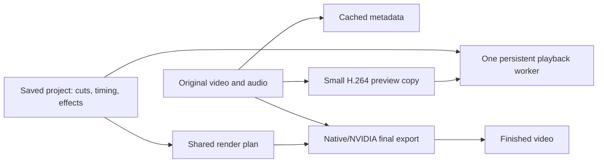

# Lightweight editing module review

Reviewed October 20, 2026. Target confirmed by the user: **8 GB RAM / four CPU cores minimum; 16 GB RAM / eight CPU cores recommended**.

Recommendation: add a compact, non-destructive editor that uses small preview copies and exports from original media. Reuse the existing Avalonia interface and native/NVIDIA FFmpeg processing. Start with the editing tasks needed to prepare social videos, then expand after profiling actual minimum-spec hardware.

This is a local architecture/code review, not an implementation of the editor. The Code Review connector exposed in this session supports pull-request CI diagnostics; no PR was supplied, so no remote review or CI check was requested. Production code and release progress are unchanged.

## Current foundation

The module already has crop/reframe, speed/FPS controls, color settings, LUTs, audio processing, split jobs, native and NVIDIA export, source-based bitrate control, and a persistent export queue. The source-based export budget and unchanged-media stream-copy path are useful building blocks. Keep them.

The current preview is a single BMP image rendered by a newly started FFmpeg process after a slider/settings update. The displayed timeline is a timestamp slider, not a multi-clip video timeline with synchronized playback. Adding more effect controls alone will not supply a usable interactive editor.

The Dubbing module already has timeline interaction code. Reuse interaction ideas, selection, and ruler behavior after extracting reusable controls; keep the new video-project model independent of dubbing-specific speakers, subtitle segments, and audio-inference services.

## Review findings to fix first

### [P1] Metadata probes are not bounded by export concurrency

`855Media.Core/Editing/VideoQueueManager.cs:225–245` starts a separate fire-and-forget probe for every enqueued file. `MaxConcurrency` limits export workers, not those probes. A large import can launch many FFmpeg processes concurrently on a four-core PC, even with export concurrency set to one.

Add a bounded media-import queue, initially one probe worker in the minimum profile and at most two in the recommended profile. Cache metadata by source identity. Coalesce identical probes, cancel removed imports, and await process termination before releasing the worker slot. Interactive preview should outrank background import/proxy work.

### [P2] Preview bitmaps do not have deterministic disposal

`855Media/ViewModels/Components/VideoEditorViewModel.cs:2403–2406` creates a new Avalonia Bitmap and replaces `PreviewImage`. The clear path and `Dispose(bool)` also do not dispose the displayed bitmap. Repeated seeking/settings changes have no explicit bound on the lifetime of old native image resources.

Swap image ownership on the UI thread and release the retired image at a safe render boundary. Dispose any generated bitmap that becomes stale before display, and release the final bitmap when the view/model closes. Avalonia explicitly exposes disposal for these resources. [Avalonia Bitmap.Dispose](https://api-docs.avaloniaui.net/docs/M_Avalonia_Media_Imaging_Bitmap_Dispose)

### [P2] Preview effects can use export-sized intermediate frames

`855Media/ViewModels/Components/VideoEditorViewModel.cs:2349–2360` builds the aspect-ratio filter using the selected export resolution. `855Media.Core/Editing/AspectRatioMode.cs:49–52` chooses 1080/2160-wide output canvases. Although `VideoPreviewService` first scales the source down, the supplied crop/blur/reframe graph can enlarge it again before final comparison scaling.

Build the same normalized edit decisions at preview dimensions, rather than passing export dimensions into the preview graph. For minimum hardware, use a 540p preview with a 360p fallback; export resolution should not change preview work into a 4K filter pass.

### [P2] Histogram work runs even when the histogram is hidden

`855Media/ViewModels/Components/VideoEditorViewModel.cs:2409–2417` calculates all histogram bins and path strings for every successful preview, regardless of `ShowHistogram`. From the UI entry path, the awaited method resumes on the UI context, so this also adds work to slider responsiveness.

Skip hidden histograms. When visible, calculate sampled histogram data in a background worker and publish only the latest result. Refresh on settled frames or at a low independent frequency during playback, not on every displayed frame.

### [P2] The CPU limit does not budget the whole pipeline

`855Media.Core/Editing/VideoEditorService.cs:627–640` places `-threads` before `-i`, which scopes that option to the input. Output encoding and filter pools are not explicitly budgeted by that setting. `SmartActionAnalyzer.cs:131–132` also requests automatic threading; `VideoPreviewService` has no explicit decode/filter budget. Default export concurrency is two.

Use one central resource profile across decoding, filtering, encoding, preview, analysis, and proxy creation. Set input and output thread limits in their proper scopes and control both simple and complex filter pools. FFmpeg documents separate filter thread settings and file-scoped option ordering. [FFmpeg options and threading](https://ffmpeg.org/ffmpeg.html)

Below-normal process priority is helpful but does not impose a RAM limit or a total thread budget. On minimum hardware, start with one export and one preview worker, and suspend competing proxy/import/analysis work while playback is active.

### [P2] Preview cancellation does not serialize process retirement

`855Media/ViewModels/Components/VideoEditorViewModel.cs:2301–2306` cancels the old request and immediately starts another. `VideoPreviewService.cs:249–260` kills on cancellation but does not await full termination. Rapid scrubbing can overlap retiring and replacement processes. Closing the grading panel does not explicitly retire outstanding preview work.

Use one latest-request-wins preview worker: one active operation, one replaceable pending request, generation IDs to reject stale results, cancellation followed by awaited process exit, and cancellation on close or media removal. Cache nearby frames so slider movement does not always restart decoding.

## Architecture

**Save edit decisions, not intermediate edited videos.** A project stores media references, source in/out times, sequence order, playback speed, normalized crop/transform, color parameters, audio gain/fades, and text/subtitle overlays. Undo/redo changes this small model. Source media is read-only during editing.

Do not use the existing physical split operation for a timeline cut: `SplitVideoCustomAsync` moves originals to an `original` folder, and split-job cleanup can delete intermediate source files. Those batch-workflow behaviors must stay outside the editor's project model. Timeline cuts should change references only; write output when the user exports.

**Use proxies for interaction and originals for final output.** This is an established editor design: Kdenlive documents reduced copies for editing and substitution of original sources for final rendering. [Kdenlive proxy workflow](https://docs.kdenlive.org/en/project_and_asset_management/project_settings/proxy_settings.html)

A preview copy is a low-resolution video, not a directory containing every extracted source frame. Keep the removed external upscaling engine and frame-inference pipeline removed.

Introduce an `IPreviewPlayer` abstraction with one persistent decoder/player. Evaluate a Windows native playback backend against a minimal FFmpeg-based backend before choosing a shipping dependency. The current one-process-per-still path remains useful for paused inspection, but should not simulate continuous playback. Do not bundle multiple complete media runtimes by default.

Compile the same normalized edit model for preview and export. Dimensions can differ, but crop coordinates, timing, effects order, text positioning, and audio gains must agree. Export must use originals, not proxies. For variable-frame-rate input and speed changes, preserve source-time mapping; do not treat a proxy frame index as an original frame index.

## Scope for a useful first version

| Editing task | First version |
| --- | --- |
| Arrange videos | One main video track, drag reorder, trim handles, split at playhead, delete/ripple delete |
| Framing | 9:16, 16:9, 1:1; crop, rotate, flip, fit/blur background |
| Speed | Constant 0.5×–2× speed with synchronized audio; preserve pitch option |
| Color | Brightness, contrast, saturation, temperature, a small preset list |
| Audio | Original audio plus one music/voice track; volume, mute, fade in/out |
| Text/captions | Text/logo overlay and editable imported SRT captions; safe font fallback |
| Transitions | Cuts and a simple fade; add crossfades after the basic render plan is verified |
| Project workflow | Save/load, undo/redo, autosave and recovery, relink missing media |
| Export | Original-size, 720p, 1080p; source-bitrate/smaller-file/explicit higher-quality choices with estimated size |

Keep advanced denoising, face enhancement, stabilization, auto-reframe analysis, transcription, background removal, and large AI downloads outside default live preview. Existing optional processing can remain export-time or on demand. None is required to trim, crop, add text/music, and export useful social videos.

## Hardware profiles

These are proposed defaults and acceptance targets, not measured guarantees.

| Setting | Minimum: 8 GB / 4 cores | Recommended: 16 GB / 8 cores |
| --- | --- | --- |
| Preview | 540p, lower to 360p when needed | 720p; optional 1080p after measurement |
| Playback target | 24/30 FPS for basic edits | 30 FPS; 60 FPS only when measured sustainable |
| Proxy codec | H.264, short GOP, bounded bitrate | H.264, short GOP, bounded bitrate |
| Active exports | One | One during editing; consider two only while idle with sufficient RAM |
| CPU starting budgets | Decode 1, filters 1, encode 2 threads | Decode 2, filters 2, encode 4 threads |
| Metadata workers | One | At most two |
| Proxy generation | One, deferred during playback/export contention | One, background and throttled |
| Preview frame queue | Two or three frames maximum | Two or three frames maximum |
| Effects during playback | Basic transforms/color; expensive effects deferred | Basic transforms/color, selectively allow measured effects |

Hardware decode/encode is optional acceleration. A supported integrated GPU can help; the minimum profile must remain usable through a tested CPU fallback. Core count alone is not a performance guarantee across CPU generations. Profile against CPU time, available RAM, sustained decode speed, and disk behavior, not RAM capacity alone.

## Keep memory and disk predictable

- Bound preview frames and thumbnails; virtualize off-screen clips and thumbnail requests.
- Cache proxies, waveform summaries, and sparse thumbnails on disk, keyed by source identity and generation profile. Evict unused data by a disk budget and protect active project assets.
- Generate a proxy only when needed. Let the user start trimming with sparse original-frame previews while it builds; never block the entire interface on every import.
- Give interactive playback/seek priority over background import, analysis, proxy generation, and exports. Resource scheduling should also account for other app modules; low-spec mode must not assume the full host RAM is free while LDPlayer or dubbing jobs run.
- Start with engineering goals of under 400 MB idle and under 1.5 GB for the app plus active preview/media workers during basic editing on the minimum machine. These require measurement; existing app-wide services and other active modules count toward the budget.
- Keep exports streaming. Avoid full raw-video buffers, whole-video waveform arrays in memory, and rendering a new intermediate file for every edit.
- Inherit subscription execution checks for import/edit/proxy/render work. Cancellation/Stop and Settings → Subscription must remain accessible after expiry. Never restore the removed engine or legacy free access.

## Implementation order

1. **Performance foundation:** bound probe and preview workers; dispose retired images; avoid hidden histogram work; add preview-specific dimensions and explicit thread budgets. Instrument process count, working set, seek latency, and dropped frames.
2. **Project model:** define clips/timing/edits, undo/redo, autosave, media relinking, and an independent shared render plan. Test timing and transforms without requiring the UI.
3. **Proxy playback:** persistent player, asynchronous H.264 proxy cache, cancellation, A/V clock synchronization, seek coalescing, and sparse/visible thumbnails.
4. **Useful timeline:** trims, splits, ordering, crop/speed/color, one audio track, text and SRT. Reuse timeline UI interactions without coupling to dubbing inference.
5. **Export and validation:** render from originals using native/NVIDIA support, retain CPU fallback and source-based file-size controls, verify final A/V sync and preview/export agreement.

## Acceptance checks

Use an actual four-core/8 GB PC and an eight-core/16 GB PC, including integrated graphics and a system with hardware acceleration unavailable. Do not infer minimum-machine performance from the developer workstation's RTX GPU.

- 1080p H.264 footage, 4K HEVC input through proxies, variable-frame-rate phone clips, portrait clips, and long GOP seeking.
- Import 100 files: bounded probes/processes and responsive cancellation; no process burst proportional to file count.
- 20-minute editing session with repeated scrubbing, color slider changes, source switching, panel close/reopen, and undo/redo: no monotonic memory climb or retired decoder accumulation.
- Cached seek goal below 250 ms at the 95th percentile on the minimum machine; first-time uncached seeks and proxy generation are measured separately.
- Sustained basic-edit proxy playback at the selected 24/30 FPS target without audio drift; preview quality falls before the UI becomes unresponsive.
- Export while editing: one render worker, stable UI response, and prompt Stop. Simultaneous-module workloads must respect the same resource budget.
- Speed edits, trims, captions, and audio fades produce matching preview/export timing. Check VFR and fractional frame rates explicitly.
- No-change operations copy streams where compatible; speed-only source-bitrate exports should shrink approximately with duration. Estimates must allow overhead and encoder variation.

## Verification performed for this review

The current Upscaling test group passes: **158 passed, one existing manual speech-isolation integration test skipped, zero failed**. This verifies the existing processing tests, not a future timeline player, memory stability, proxy performance, or minimum-hardware readiness. No new runtime performance guarantee is established by this review.
