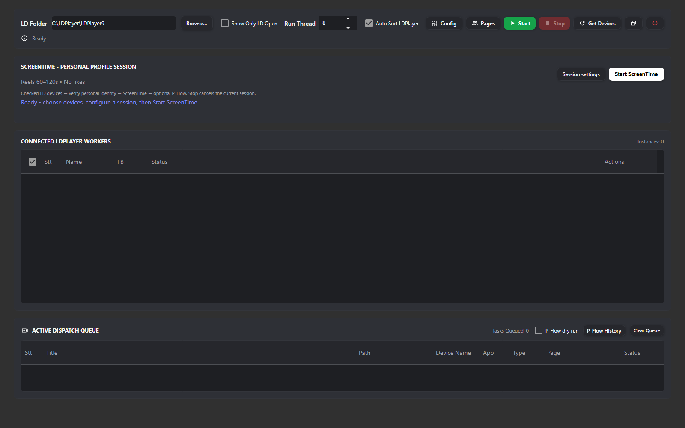
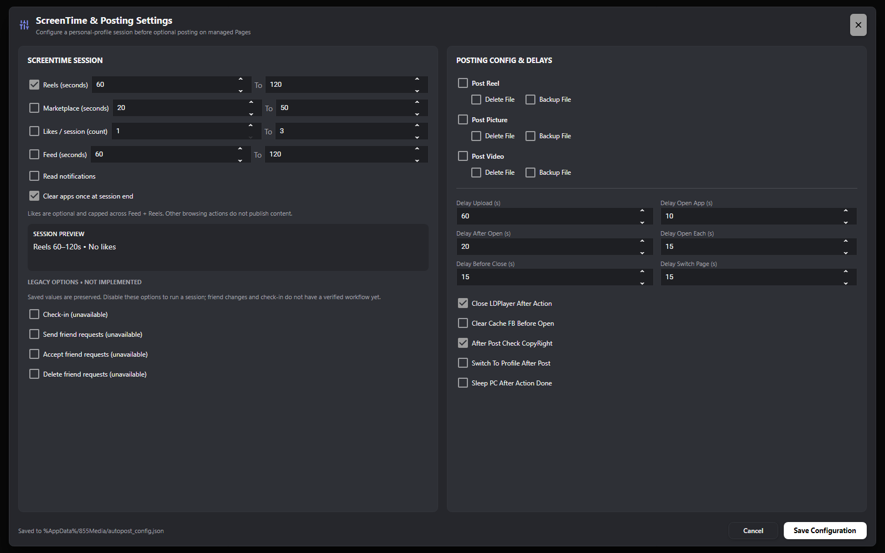

# ScreenTime completion report

Completed: 2026-10-10 05:12:17 +07:00

## New workflow

Checked LD devices → boot and validate Android/internet → verify root owner and selected personal identity → Notifications / Feed / Reels / Marketplace → optional P-Flow target verification and posting → clear apps once if selected → optionally close LD.

- `Start ScreenTime` runs only the personal-profile session; queued posts are left alone. The main Start runs selected ScreenTime actions before enabled P-Flow jobs.
- The complete lifecycle holds the existing device lease. Standalone ScreenTime service calls acquire the same lease, preventing competition with posting.
- Personal identity is mandatory and uses the existing root/native switcher verification. Unresolved P-Flow jobs continue to block reuse of that device.
- Native accessible tabs are preferred for navigation. When none is exposed, the existing deep link can open the route, but the actual hierarchy must verify the screen before any action. Navigation is bounded and checked again before each browsing action.
- Enabled actions use inclusive valid ranges; duration loops measure actual elapsed time and cap dwell waits to remaining time. Likes have one sampled upper limit across Feed and Reels, and remain opt-in.
- Service progress updates per-worker rows and the dashboard, and writes ScreenTime step/completion entries to `%AppData%/855Media/logs/p-flow.log`.
- Cancellation stops actions and respects cleanup choice. Unknown posting preserves its screen for reconciliation. Batch summaries report worker errors/cancellation instead of unconditional success.

## Settings and interface

- Renamed `LDAccountWarmupSettings.cs` / class to `ScreenTimeSetting.cs` / class.
- Added `IScreenTimeService` and `ScreenTimeService`; registered and injected the service into the real ViewModel execution path.
- Removed duplicate inline activity code. `ScreenTimeSetting.FromConfig` maps the existing flat JSON fields; saved preferences and ranges retain their keys and values.
- Defaults now match the actual existing AutoPost configuration, including likes off. The old unused class had different defaults.
- New ScreenTime dashboard card: session summary, personal-profile targeting explanation, settings/start controls, live progress and validation feedback.
- Settings show explicit seconds/counts, session preview, opt-in likes and cleanup, and Cancel restores edits. Settings are written via a temporary file and atomic replacement.
- Legacy friend mutations and check-in were not implemented in the original execution path. Their saved settings remain available, but enabling them produces a preflight error; UI explicitly labels them unavailable. No new public action is silently enabled.

## Media paths review

- File/Folder controls, tooltip paths, extension filtering, top-level file counts, explicit Clear, category opt-in, draft Cancel and persistence were reviewed and checked.
- Found and fixed the worktree row constructor erasing later media paths while initializing earlier ones. The runtime checkout already had an equivalent initialization guard; that existing implementation was retained.
- Path persistence was checked with a temporary JSON file, not the user's production Page data.

## Verification

- Worktree solution build: 0 warnings, 0 errors.
- Runtime solution build in a separate output directory: 0 warnings, 0 errors.
- Focused LDPlayer tests: **239 worktree / 304 runtime passed**.
- ScreenTime-focused tests: **23 passed** (includes the two renamed settings tests).
- Temporary media path probe: **12 checks passed**.
- Headless UI probes in both checkouts passed Page-draft Cancel, bulk-path Cancel and ScreenTime settings Cancel; rendered dashboard and settings at 1600×1000. Reviewed the dark-theme render for layout and contrast; added explicit preview foreground resources for theme compatibility.
- `git diff --check` passed in both checkouts. Existing unrelated changes were retained; no commit/push was performed.

## Limits and next use

- FB-01 and recognized English Facebook screens are supported. Unknown layouts stop with an actionable error.
- No live Facebook posting, likes, friend changes, or browsing session was performed during this task. Emulator session navigation still needs a controlled user run; headless UI rendering and mock workflow tests do not establish live Facebook behavior.
- Friend/check-in workflows remain unavailable, rather than silently doing nothing. Saved values are preserved and can be disabled in settings.
- Restart the app from `D:\repos\855Media\855Media` using `dotnet run`. Fetch accounts if a device has no mapped personal profile, select checked devices, review Session settings, then use Start ScreenTime. Resolve any Unknown P-Flow jobs first.
- Existing unrelated posting options were preserved; this task did not add product-level calendar scheduling.
